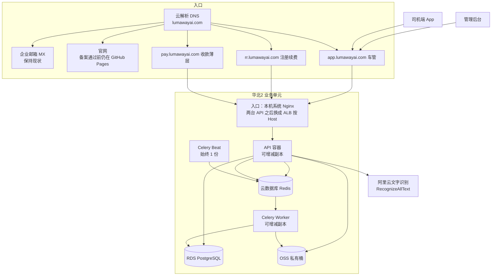

# 全国推广服务器选型与分阶段部署建议

- 修订日期：2026-10-16。
- 适用系统：车管（`vihiclemanagement` / `cg-system`）、注册续费（`rr-system`）、收款薄层（`pay-system`）。车管和注册调用阿里云文字识别，不自建 OCR。收款不自建订单库。后续新服务先放同一台机器。
- 主体与域名：北京溯光而行科技有限公司，`lumawayai.com`（阿里云注册，企业实名已通过）。详见 [12-配置域名](12-配置域名.md)。收款见 [18-收款服务](18-收款服务.md)。
- 已确认范围：前期只开华北 2（北京）一个业务单元。华南及其他地域不采购。
- 当前进度：网站 ICP 已通过（京ICP备2026067930号-1）。华北 ECS `39.107.61.144` 已作为备案接入并复用。`pay.lumawayai.com` 已解析到该 IP。官网 `@`/`www` 仍在 GitHub Pages。下一步：本机只装一套系统 Nginx，先上 pay 的 HTTPS 页供支付进件。

应用内部仍是模块化单体（FastAPI、Celery、PostgreSQL、Redis、对象存储）。本文只定云上怎么放、先买什么、以后怎么加减。应用分层见 [00-架构设计总览](00-架构设计总览.md)。

## 1. 推荐结论

云厂商定为 **阿里云**，地域定为 **华北 2（北京）**。域名、企业邮箱、发票抬头和文字识别已经在阿里云，备案接入也必须用同一账号下的内地服务器。本轮不再把腾讯云、华为云当作并行采购方案。

OCR 使用阿里云 `RecognizeAllText`（身份证、驾驶证、行驶证）。识别容量靠接口配额和费用，不买 CPU 推理机，不买 GPU。

正式形态是一个华北业务单元：无状态应用、托管数据库、托管 Redis、私有对象存储、阿里云 OCR。每个组件可以单独加上、升配或撤掉，不加组件时不预留空机器。

应用 ECS 已买：**1 台**华北 2，公网 `39.107.61.144`，同时跑车管、注册续费和收款入口，也是备案接入。内存或 CPU 持续吃紧时，把同一台升到 8 vCPU / 32 GiB，不为此另买服务器。RDS、Redis、OSS、负载均衡在有真实客户数据前再开，不要一次买齐。

## 2. 正式技术架构

### 2.1 原则

1. 有状态的数据不放在 ECS 磁盘上。ECS 只跑容器，坏了或加减机器不搬数据库。
2. 应用通过环境变量连接数据库、Redis、对象存储和 OCR。换托管服务只改配置，不改部署拓扑的代码。
3. 网络按两可用区一次建好。首期只在其中一个可用区放机器。
4. 对外只暴露网站入口。数据库、Redis、对象存储内网访问，OCR 由 API 服务器主动调用。
5. 定时调度全局只跑一份。加 worker 不等于加 Beat。
6. 新地域是以后另做一套业务单元，不是把华北机器复制到华南。前期所有企业都归属华北。
7. 同一台 ECS 可以放多个服务。车管和注册不共用数据库、Redis、文件桶和密钥。收款是无状态薄层，不占第三套库。容量不够时先升配这台机器，再考虑把某一个服务拆出去。
8. 公网只暴露一套系统 Nginx（80/443）。不装宝塔。Compose 内的 Nginx 不对公网映射 80/443。应用只监听 `127.0.0.1`。
9. Cookie 不要写到 `.lumawayai.com`。三个站点会话隔离。
10. 第二台 API 时用 ALB **按 Host** 分流，不要公网 Nginx 和 ALB 叠两层。`pay.lumawayai.com` 保持唯一支付回调域名。

### 2.2 华北业务单元

| 组件 | 首期落点 | 加上 | 撤掉或缩小 |
|---|---|---|---|
| 应用 ECS | 1 台，跑 Nginx、API、Worker、Beat | 另一可用区再加 1 台 API；Worker 可拆到独立 ECS | 缩回 1 台。最后一台不能放，它是备案接入 |
| 入口 | 公网 IP `39.107.61.144` + 系统 Nginx，按 Host 分到 pay/app/rr | 第 2 台 API 时加 ALB **按 Host** 分流，DNS 改指向 ALB，拿掉对外 Nginx | 回到单机时去掉 ALB，DNS 改回 EIP |
| PostgreSQL | 对外前开通 RDS，跨可用区高可用 | 升配、加存储、只读实例 | 按控制台允许的规格降配。不迁回 ECS 磁盘 |
| Redis | 对外前开通主从高可用，1GB 起 | 升内存 | 降配。内存不够时扩容，不用淘汰策略丢队列 |
| 附件 | 北京私有 OSS | 容量按量增长；备份用另一个桶 | 删桶前先迁走对象 |
| OCR | 阿里云 API，无服务器 | 提高 QPS 或买资源包 | 停用密钥后改为手工录入 |
| CDN | 不开 | 只给公开静态资源 | 解析改回源站。证件不进 CDN |
| 第二地域 | 不开 | 客户分布或容灾要求明确后再建完整业务单元 | 企业迁回华北后释放该地域 |

管理后台和 API 首期共用 `app.lumawayai.com`。司机端以后走同一主机。不在首期拆出独立的 API 域名。注册续费用 `rr.lumawayai.com`，不要用路径 `/rr/` 和车管共用 Host。收款用 `pay.lumawayai.com`，只做跳转和支付回调，订单在车管库或注册库。

### 2.4 同机三入口（2026-10-16 确认）

一台系统 Nginx，三个 `server_name`。不装宝塔。Compose 不对公网映射 80/443。

| 项 | 车管 | 注册续费 | 收款 |
|---|---|---|---|
| 域名 | `app.lumawayai.com` | `rr.lumawayai.com` | `pay.lumawayai.com`（解析已生效） |
| 目录 | `/opt/cg-system` | `/opt/rr-system` | `/opt/pay-system` |
| 本机端口 | `127.0.0.1:8001` | `127.0.0.1:8002` | `127.0.0.1:8003`（静态期可只走 Nginx 根目录） |
| 数据 | 独立 PG / Redis / OSS | 独立，不连车管 | 无库。商户密钥只在 pay。幂等在被通知的业务侧 |
| Beat | 1 | 1 | 不要 |

TLS 优先 `*.lumawayai.com`。进件网站填 `https://pay.lumawayai.com`，文案为公司软件与技术服务收款，两套业务共用一个商户号。SSH 密钥本机 `~/Documents/Sohu-Doc/env/profiles/keys/lumaway-ecs.pem`，菜单名 `Lumaway-Web-BJ`，不入库。

### 2.3 域名怎么分

根域名上已有企业邮箱和 GitHub Pages，业务解析不能覆盖这些记录。

| 记录 | 现在（ICP 已通过） |
|---|---|
| `@` 的 A | GitHub Pages，不要改到 ECS |
| `www` 的 CNAME | `lumaway-ai.github.io` |
| MX、SPF、DKIM、DMARC | 阿里企业邮箱，始终保留 |
| `pay` | A `39.107.61.144`，已写入 |
| `app` / `rr` | 待加 A 到同一 IP |

不要把 `lumawayai.com` 或 `www` 指到这台 ECS，企业邮箱会断。GitHub Pages 继续做官网。业务页脚挂京ICP备2026067930号-1。

通过后，备案信息里的网站要能在阿里云华北接入上打开，页脚放置备案号。GitHub Pages 可以继续做预览；对外官网以已备案接入为准。

## 3. 分阶段

| 阶段 | 做什么 | 不做什么 |
|---|---|---|
| 本周：备案接入 | 已完成：华北 ECS `39.107.61.144`，ICP 已过 | — |
| 备案通过：入口 | 系统 Nginx + `pay` HTTPS 页；再加 `app`/`rr` 解析 | 不装宝塔；不把 `@` 指到 ECS；不一次买齐 RDS |
| 有真实客户数据前 | 开 RDS（两个库）、云 Redis、OSS，部署车管和注册 | 不把 PostgreSQL 长期留在 ECS 上；pay 不进 RDS |
| 华北内扩展 | 按负载加 API 或 Worker，需要连续发布时再加 ALB | 不因为单机维护窗口就提前买双机 |
| 其他地域 | 按企业归属新建业务单元 | 不按访问者 IP 切换数据库 |

上线前在本地完成回归。涉及迁移时，用脱敏备份验证升级和回退。正式库上不跑破坏性测试。

单台 API 重启会有中断，放在维护窗口。需要不停机发布时，再买第二台并接入健康检查。

## 4. 本周购买：一台应用服务器

购买目的有两件：生成 ICP 备案服务码；这台机器直接成为架构里的应用节点，避免另买一台只用于备案、之后闲置的轻量服务器。

| 项 | 购买选择 |
|---|---|
| 账号 | 北京溯光而行科技有限公司的阿里云账号 |
| 地域 / 可用区 | 华北 2（北京）。实例放在有库存的一个可用区 |
| 规格 | `ecs.g8i.xlarge`，4 vCPU / 16 GiB；无库存时用同档通用型，仍是 4 vCPU / 16 GiB |
| 镜像 | Ubuntu 22.04 或 Alibaba Cloud Linux 3，x86_64 |
| 系统盘 | ESSD 100GB |
| 公网 | 分配公网 IP。备案期间固定带宽 5Mbps |
| 时长 | 包年包月 12 个月。备案要求购买时长大于 3 个月并开通公网带宽，按月或试用实例不能备案 |
| 网络 | 新建 1 个 VPC；两个可用区各 1 个交换机。ECS 只挂其中一个 |

不要买这些：

- 轻量应用服务器。它不能作为这套 VPC 里的长期应用节点。
- 按量付费、抢占式实例。备案期间实例不能释放，抢占式会被回收。
- GPU、8 核 OCR 机、第二台 ECS、华南地域。
- 为了备案提前购买 RDS 或负载均衡。这两项不提供网站备案服务码。

买好后在阿里云 ICP 代备案系统用这台 ECS 生成备案服务码，再提交。审核期间不要释放实例、不要更换地域、不要把域名指过来。北京主体由北京通信管理局审核。

安全组：SSH 只对运维来源 IP 开放；80/443 可开放，但域名尚未指向本机。PostgreSQL、Redis、对象存储端口不对公网开放。这台机器上最终也不监听这些端口。

备案期间可以用空库做部署演练。客户证件、账单和账号不要放在系统盘上的数据库里。

### 4.1 车管和注册续费能否同机

可以。两个系统都是 FastAPI 单体加少量后台任务，OCR 在阿里云，不占本机推理。当前车管规模约 300 名司机；注册续费是代理填报，并发更低。4 vCPU / 16 GiB 覆盖两边一起跑，并留下以后再加一个同类服务的余量。

现有编排里的内存上限是容器配额，不是常驻占用，用来判断 16 GiB 够不够：

| 系统 | 编排里的主要配额 | 约计 |
|---|---|---|
| 车管 | API 1 GiB、Worker 1 GiB、Beat 256 MiB、PostgreSQL 1 GiB、Redis 640 MiB，另有 Nginx 与 MinIO | 约 5 GiB |
| 注册续费 | PostgreSQL 512 MiB、Redis 256 MiB、MinIO 512 MiB；API 与前端未设硬限额，加上以后的 Worker、Beat | 约 3 GiB |
| 系统 | 操作系统与 Docker | 约 1.5 GiB |

合计约 10 GiB，16 GiB 仍有余量。CPU 配额加总会超过 4 核，那是单容器上限，不是两边会同时打满。证件上传多的时候，先把备案期的 5Mbps 调高，而不是先加 CPU。

同机时保持隔离，沿用注册续费部署方案里的边界：

| 项 | 车管 | 注册续费 |
|---|---|---|
| 目录 | `/opt/cg-system` | `/opt/rr-system` |
| Compose 项目 | `cg-system` | `rr-system` |
| 数据库、Redis、文件卷 | 独立 | 独立，不连车管库 |
| 入口 | `app.lumawayai.com` | `rr.lumawayai.com`（不要用路径 `/rr/`） |
| OCR 密钥 | 各自配置 | 不从车管 `.env` 复制 |

两个入口都在这台 ECS 上，备案仍是 `lumawayai.com` 这一个网站。子域名不单独再备。以后把某个服务迁到新 ECS，才需要给新机器新增接入。

磁盘 100GB 够系统、镜像和早期数据库。附件进 OSS 之前不要把证件堆在系统盘。磁盘不够时单独扩 ESSD，不必换机器。

### 4.2 以后怎么加容量

按这个顺序，不要跳到买第二台：

1. 看监控。内存持续高于约 75%，或 CPU 持续打满、接口变慢，再动手。
2. 同一实例升配：`ecs.g8i.xlarge`（4 vCPU / 16 GiB）升到 `ecs.g8i.2xlarge`（8 vCPU / 32 GiB）。实例 ID 不变，备案服务码仍绑在这台机器上。规格变更一般要短暂停机，放在维护窗口。
3. 数据库、Redis、附件改到 RDS、云 Redis、OSS 后，本机只剩 API 和任务，同一规格还能再留更久。
4. 升配之后仍然不够，或某个服务要单独发布、单独故障隔离，再把那个服务拆到新的 ECS。新机器加入同一 VPC。
5. 再增加的服务，先以独立目录和独立数据库放上这台机器，用同一套判断决定升配还是拆出。

## 5. 备案通过后的华北正式配置

仍是这一台应用 ECS，车管和注册续费继续同机。数据库、缓存和附件改到托管服务，本机对应容器停掉。一套 RDS 里建两个库，一套 Redis 用不同库号，OSS 分两个桶。不要把两套业务表放进同一个库。

| 服务 | 配置 | 说明 |
|---|---|---|
| 应用 ECS | `39.107.61.144`，4 vCPU / 16 GiB | 一台系统 Nginx。车管、注册各一套 API、Worker、Beat。pay 无状态。每个业务 Beat 只留 1 个 |
| PostgreSQL | RDS PostgreSQL 16，高可用，2 vCPU / 8GB，存储 100GB，跨可用区 | 正式数据只放这里。规格以控制台可选高可用档为准，不低于这一档 |
| Redis | 主从高可用，可用容量 1GB 起 | 缓存与 Celery 分库。内存政策保持不淘汰，满了就升配 |
| OSS | 北京私有 Bucket 1 个，开版本管理 | 保单、证件、合同、导出文件。预签名访问 |
| 备份 | RDS 自动备份，另 1 个私有备份桶 | 应用密钥不能删除备份桶。首期同地域，异地复制以后再开 |
| 公网 | 带宽调到按 20Mbps 评估，或改为按量 | 与负载均衡、出网流量分开计价 |
| OCR | 开通文字识别，RAM 子账号仅 OCR 权限 | 见第 6 节 |
| 证书 | `app.lumawayai.com` 的 DV 证书 | 根域名现有 Let's Encrypt 继续给官网用，不迁到这台 ECS |
| 日志与监控 | 云监控 + 日志服务，按量 | 区分 API、任务、数据库。设置费用告警 |

应用连接约定：

| 变量 | 正式值 |
|---|---|
| `DATABASE_URL` | RDS 内网地址 |
| `REDIS_URL` / Celery | Redis 内网地址，缓存和队列使用不同 DB |
| `S3_ENDPOINT` | 北京 OSS 的 S3 兼容内网地址 |
| `OCR_PROVIDER` | `aliyun` |
| `OCR_ALIYUN_REGION` | `cn-hangzhou`。文字识别只有杭州接入点 |

OSS 的 S3 兼容接口与 MinIO 有差异。切换前要验证预签名上传、完成检查、预览、下载、删除和跨域，不能只改地址。说明见 [OSS S3 兼容性](https://help.aliyun.com/zh/oss/developer-reference/compatibility-with-amazon-s3)。

镜像推到容器镜像服务 ACR，发布使用可追溯标签。现有 Compose 仍是首期发布方式；多机之后再把同一镜像分到多台 ECS。

## 6. OCR

生产只调用阿里云文字识别统一接口 `RecognizeAllText`。API 进程持有 RAM 密钥，从华北 ECS 访问公网接入点 `ocr-api.cn-hangzhou.aliyuncs.com`。该产品目前只提供杭州接入点；VPC 接入点也只给杭州 ECS 使用，不为了走内网把应用改放到杭州。证件不经过自建 OCR 端口，日志不记录原图和识别原文。接入点见 [文字识别服务接入点](https://help.aliyun.com/zh/ocr/developer-reference/api-ocr-api-2021-07-07-endpoint)。

不部署 PaddleOCR，不购买推理服务器，不采购 T4 / A10。代码里保留的本地推理开关只用于开发排障，不进入正式环境和采购清单。

识别失败、超时或配额用尽时，附件仍保存，页面改为手工录入。账单、收款和档案不依赖 OCR 可用。

用量上来之后，先看控制台的 QPS 和调用量，再提配额或购买资源包。这个步骤不增加 ECS。

## 7. 华北内怎么扩展

观察到持续现象再加资源。加之前先有监控，而不是按预计用户数一次买齐。

| 现象 | 调整 |
|---|---|
| API 负载高，或不能接受单机重启中断 | 在另一个可用区加 1 台同规格 ECS，前面加 ALB，健康检查通过后把 `app` 指到 ALB |
| 导出、账单、通知积压 | 加 Worker 副本。定时 Beat 仍只留 1 份，任务保持幂等 |
| Worker 与 API 抢同一台机器的 CPU | 把 Worker 拆到 1 台 2 vCPU / 4 GiB 或 4 vCPU / 8 GiB 的 ECS，共用同一 Redis |
| 数据库 CPU、连接或存储持续偏高 | RDS 升配或加存储。确认维护窗口 |
| Redis 内存接近上限 | 升配。不改为淘汰后继续跑队列 |
| 文字识别排队或被限流 | 提高 OCR 配额或购买资源包 |
| 公开页面静态流量变大 | 再开 CDN。证件 Bucket 保持私有 |

缩容按相反顺序：先把 DNS 或上游从被摘除的实例拿开，确认无流量，再释放。备案服务码所在的那台 ECS 保留到接入变更完成之后。

新增一台对公网提供网站的 ECS、或给该域名开通 CDN / OSS 自定义域名，要在备案里新增接入。RDS 和 Redis 不开公网，不单独备案。

## 8. 其他地域（后期，现在不买）

客户主要不在华北，或明确要求地域级灾备时，再评估华南（深圳）。新地域是另一套 API、RDS、Redis、OSS，企业固定归属一个地域。员工出差仍访问企业所属地域，不按当时 IP 切库。

跨地域经营报表用汇总数据，并标明更新时间。企业迁移时先停旧地域写入，再切路由，避免两地同时写同一企业。

OCR 仍走阿里云杭州接入点，不在每个地域部署识别服务。

异地备份不等于热备。启用前单独定可接受的数据丢失时间和恢复时间。RDS PostgreSQL 的跨地域备份需要单独开通，且部分规格不支持，购买时核对，不能从「高可用」推断出异地恢复。[跨地域备份说明](https://help.aliyun.com/zh/rds/apsaradb-rds-for-postgresql/use-the-cross-region-backup-feature-for-an-apsaradb-rds-for-postgresql-instance)。

## 9. 备份

| 对象 | 方式 |
|---|---|
| PostgreSQL | RDS 自动备份。恢复演练在新实例上做，不覆盖正式库 |
| OSS | 版本管理。每日把附件同步到独立备份桶 |
| Redis | 高可用与持久化按控制台开通。队列和会话可以重建，不作为账务数据来源 |
| ECS | 系统盘快照。业务数据不在这张盘上 |
| 密钥与证书 | 离线保管。RAM 密钥可轮换 |

首期备份留在北京。同地域备份不能应对地域级故障。

## 10. 采购清单

### 10.1 本周

| 项目 | 规格 | 数量 |
|---|---|---|
| ECS | 华北 2，4 vCPU / 16 GiB，ESSD 100GB，包年 12 个月，公网 5Mbps | 1 |
| VPC | 1 个 VPC，2 个可用区交换机，1 个安全组 | 1 套 |

询价可发给阿里云：

> 请报华北 2（北京）包年 12 个月价格：通用型 4 vCPU / 16 GiB ECS 一台，系统盘 ESSD 100GB，固定公网带宽 5Mbps。并确认该实例可生成网站 ICP 备案服务码、可选可用区库存，以及续费价。不要报价 GPU、轻量应用服务器、第二台 ECS、RDS、Redis 和华南地域。

价格以 [阿里云价格计算器](https://www.aliyun.com/price) 和购买页为准。本文不写未经下单核对的月费。

### 10.2 备案通过、准备对外时

| 项目 | 规格 | 数量 |
|---|---|---|
| RDS PostgreSQL | 16，高可用，2 vCPU / 8GB，100GB，跨可用区 | 1 |
| Redis | 主从高可用，1GB 可用容量 | 1 |
| OSS | 北京私有桶，版本管理 | 2（附件、备份） |
| 公网带宽 | 由 5Mbps 调整到正式评估值 | 原 EIP |
| 文字识别 | 按量或资源包，RAM 子账号 | 1 |
| ACR、日志、云监控 | 按量 | 1 套 |
| 证书 | `app.lumawayai.com` | 1 |

带宽、负载均衡容量、存储请求、出网流量、备份和日志分开报价。不要用单台 ECS 的活动价代表整套成本。

### 10.3 以后按需

第二台 API、独立 Worker、ALB、CDN、Redis / RDS 升配、OCR 资源包、跨地域备份，以及华南业务单元。都不在本周订单里。

## 11. 验收

备案接入：

- [ ] ECS 在华北 2，包年剩余时间覆盖审核期
- [ ] 备案服务码已绑定这台实例
- [ ] `lumawayai.com` 的 A、CNAME、MX 与购买前一致，没有指到新公网 IP

对外前：

- [ ] API、Worker、Beat 在 ECS 上；Beat 只有 1 个
- [ ] 业务库在 RDS，附件在 OSS，本机没有作为正式库的 PostgreSQL / MinIO
- [ ] `OCR_PROVIDER=aliyun`，接入点为杭州公网 `ocr-api.cn-hangzhou.aliyuncs.com`，识别失败时可以手工保存
- [ ] `https://app.lumawayai.com` 证书有效，数据库和 Redis 不能从公网访问
- [ ] 备份已恢复演练一次
- [ ] 网站页脚有备案号，并链到 [beian.miit.gov.cn](https://beian.miit.gov.cn)
